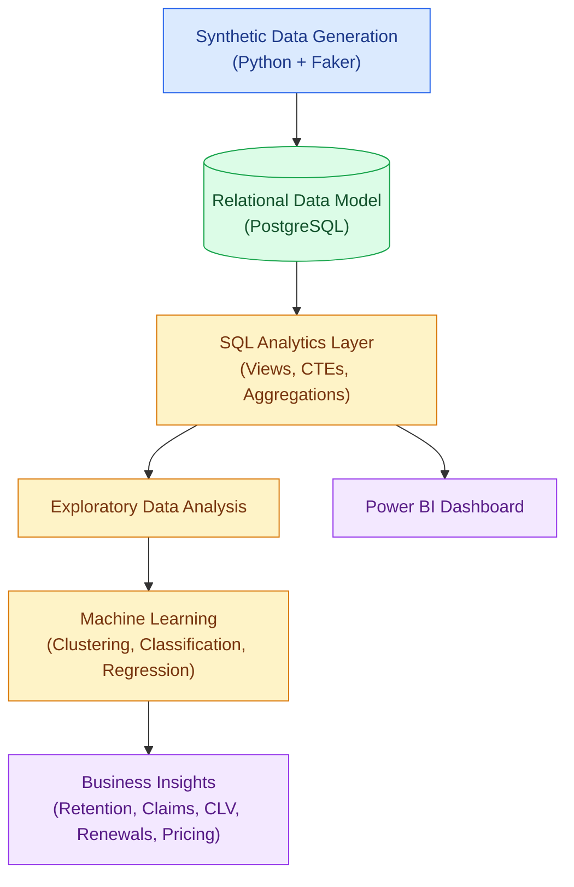

# PoliSight – Insurance Policy Intelligence & Analytics Platform


**An end-to-end insurance analytics platform combining SQL, Python, machine learning, data governance, and business intelligence to transform synthetic insurance data into actionable business insights.**

---

## Table of Contents

- [Project Overview](#project-overview)
- [Business Problem](#business-problem)
- [Project Objectives](#project-objectives)
- [Solution Architecture](#solution-architecture)
- [Technology Stack](#technology-stack)
- [Data Model](#data-model)
- [SQL Analytics Layer](#sql-analytics-layer)
- [Exploratory Data Analysis](#exploratory-data-analysis)
- [Machine Learning and Predictive Analytics](#machine-learning-and-predictive-analytics)
- [Data Calibration and Quality](#data-calibration-and-quality)
- [Power BI Dashboard](#power-bi-dashboard)
- [Business Insights and Use Cases](#business-insights-and-use-cases)
- [Business Analysis and Documentation](#business-analysis-and-documentation)
- [Project Structure](#project-structure)
- [Installation and Setup](#installation-and-setup)
- [Running the Pipeline](#running-the-pipeline)
- [Data Governance and Quality Controls](#data-governance-and-quality-controls)
- [Limitations and Future Improvements](#limitations-and-future-improvements)
- [Skills Demonstrated](#skills-demonstrated)
- [Author](#author)

---

## Project Overview

PoliSight is an insurance policy intelligence and analytics platform designed to demonstrate how structured data engineering, analytical SQL, exploratory data analysis, machine learning, and business intelligence can support insurance business decisions.

The project follows an end-to-end analytical workflow:

1. Generate synthetic insurance datasets using Python.
2. Organize the data into a relational PostgreSQL database.
3. Develop SQL queries, views, aggregations, and analytical transformations.
4. Perform exploratory data analysis to identify trends and patterns.
5. Apply machine learning techniques to investigate customer behavior and insurance outcomes.
6. Present analytical findings through Power BI dashboards.
7. Document business requirements, user acceptance testing, data governance, and data definitions.

The platform focuses on important insurance business areas, including customer retention, policy renewals, claims experience, premium performance, risk segmentation, and customer lifetime value.

**Project Repository:** [PoliSight – Insurance Analytics](https://github.com/Prathmesh717/polisight-insurance-analytics)

---

## Business Problem

Insurance companies manage large volumes of information relating to customers, agents, products, policies, premiums, claims, and renewals.

However, analyzing these datasets independently can make it difficult to identify relationships between customer behavior, policy performance, claims experience, and business outcomes.

PoliSight addresses this analytical challenge through a centralized data model and an integrated analytics workflow.

The project explores questions such as:

- Which customer segments demonstrate higher policy retention?
- How do claims and premium amounts vary across insurance products?
- Which factors may be associated with policy lapses?
- How can customers be segmented based on their characteristics and behavior?
- How can customer lifetime value be analyzed?
- What patterns can support better renewal and pricing decisions?
- How can SQL-based analytics be transformed into management dashboards?

The objective is to demonstrate a structured, data-driven approach to answering these business questions.

---

## Project Objectives

| Area | Objective |
|---|---|
| Data Engineering | Generate and organize structured synthetic insurance datasets |
| Database Management | Build a relational PostgreSQL data model |
| SQL Analytics | Develop analytical queries, views, CTEs, and aggregations |
| Exploratory Analysis | Identify trends, distributions, and relationships |
| Machine Learning | Explore classification, clustering, and regression techniques |
| Business Intelligence | Develop dashboards for insurance performance analysis |
| Data Governance | Define data quality, ownership, and governance controls |
| Business Analysis | Translate business problems into requirements and acceptance criteria |
| Quality Assurance | Prepare test scenarios and user acceptance testing documentation |

---

## Solution Architecture

The following diagram represents the project's intended analytical workflow.



### Workflow Explanation

| Layer | Description |
|---|---|
| Data Generation | Synthetic insurance data generated using Python and Faker |
| Database | Structured relational storage using PostgreSQL |
| SQL Analytics | Business-oriented queries, views, CTEs, and aggregations |
| EDA | Statistical exploration and visualization of insurance data |
| Machine Learning | Predictive and segmentation analysis |
| Business Intelligence | Power BI reporting and dashboard development |
| Business Insights | Interpretation of analytical outputs for decision support |

---

## Technology Stack

| Category | Technologies |
|---|---|
| Programming | Python 3.11 |
| Database | PostgreSQL 17 |
| Data Manipulation | Pandas, NumPy |
| Data Generation | Faker |
| Data Visualization | Matplotlib, Seaborn |
| Machine Learning | Scikit-learn |
| Statistical Analysis | Python statistical and analytical libraries |
| Query Language | SQL |
| BI and Reporting | Microsoft Power BI |
| Documentation | Markdown |
| Version Control | Git and GitHub |

---

## Data Model

PoliSight uses a relational database consisting of eight primary tables.

| Table | Purpose |
|---|---|
| `dim_date` | Date dimension for time-based analysis |
| `dim_customers` | Customer demographic and profile information |
| `dim_agents` | Insurance agent information |
| `dim_products` | Insurance product details |
| `fact_policies` | Policy-level information |
| `fact_premiums` | Premium payment information |
| `fact_claims` | Insurance claim information |
| `fact_renewals` | Policy renewal and lapse information |

### Data Model Design

The database separates descriptive information from transactional and business-event information.

- Dimension tables provide descriptive attributes.
- Fact tables capture policy, premium, claims, and renewal activity.
- Primary and foreign keys establish relationships between relevant entities.
- Database constraints support structural data integrity.

The detailed table and column definitions are documented in [`docs/data_dictionary.md`](docs/data_dictionary.md).

---

## SQL Analytics Layer

SQL is used to transform relational insurance data into business-oriented analytical outputs.

The project includes:

- Data aggregation and summarization.
- Common Table Expressions (CTEs).
- Joins across dimension and fact tables.
- Customer and policy-level analysis.
- Premium and claims analysis.
- Renewal and lapse analysis.
- Analytical views designed for reporting.

### SQL Deliverables

| File | Description |
|---|---|
| `sql/01_create_schema.sql` | Creates the relational database schema |
| `sql/02_eda_queries.sql` | Contains exploratory and analytical SQL queries |
| `sql/03_powerbi_views.sql` | Defines reporting views for Power BI |

### Example Analytical Questions

- What is the premium distribution across insurance products?
- How does claims experience vary across customer segments?
- Which policies have renewal or lapse outcomes?
- How do policy counts and premium amounts change over time?
- What is the relationship between customer characteristics and insurance outcomes?

---

## Exploratory Data Analysis

Exploratory Data Analysis is used to understand the structure, distribution, and relationships within the synthetic insurance datasets.

The analysis focuses on:

- Customer demographics.
- Policy distribution.
- Product-level performance.
- Premium distributions.
- Claims frequency and amounts.
- Renewal and lapse patterns.
- Risk score distributions.
- Customer lifetime value.

EDA helps identify data patterns, potential quality issues, and analytical opportunities before applying machine learning techniques.

---

## Machine Learning and Predictive Analytics

The project explores machine learning methods to investigate customer segmentation, policy behavior, and insurance-related outcomes.

| Technique | Analytical Purpose |
|---|---|
| Clustering | Explore customer segments based on selected characteristics |
| Classification | Investigate policy lapse and renewal-related outcomes |
| Regression | Explore customer lifetime value estimation |
| Feature Analysis | Examine relationships between customer and policy attributes |
| Model Evaluation | Assess model performance using appropriate evaluation metrics |

### Analytical Focus Areas

**1. Customer Segmentation**

Explore customer groups based on selected demographic, policy, and behavioral characteristics.

**2. Policy Lapse Analysis**

Investigate factors associated with policy lapse behavior using classification techniques.

**3. Customer Lifetime Value**

Explore regression-based approaches for estimating customer lifetime value while avoiding target leakage.

**4. Risk Analysis**

Examine the relationship between customer characteristics, policy attributes, and generated risk scores.

### Model Evaluation

Depending on the task, the analysis considers metrics such as:

- Accuracy
- Precision
- Recall
- F1-score
- ROC-AUC
- R²
- Mean Absolute Error (MAE)

The metrics must be interpreted in the context of the synthetic dataset and the assumptions used to generate it.

---

## Data Calibration and Quality

PoliSight evolved through two development iterations to address data-generation issues, improve analytical reliability, and reduce misleading model results.

The following table summarizes the historical comparison between the original and calibrated versions.

| Issue | v1 (Original) | v2 (Calibrated) | Fix |
|---|---|---|---|
| Loss ratio | 700%+ | 69.7% | Claim amounts scaled relative to annual premium rather than sum insured |
| Lapse signal | Random signal (AUC 0.50) | Risk-driven signal (AUC 0.66) | `is_lapsed` derived from a logistic probability function |
| CLV leakage | R² = 1.0, MAE = ₹0 | R² = 0.21, MAE = ₹32,927 | Removed premium-related features that mathematically defined CLV |
| Risk score | Flat 50.0 | 65.2 ± 13.5 | Score variation introduced using age, income, product line, and tenure |
| SQL views | Fan-out join issue | Pre-aggregated CTEs | Premium and claims data aggregated separately before joining |

**Important:** These figures are historical development results from earlier project analysis. They should not be interpreted as independently reproduced or currently verified metrics until the corresponding pipeline has been executed and the outputs have been validated.

### Key Improvements

- Improved the relationship between generated claims and annual premium.
- Introduced a risk-driven lapse-generation approach.
- Addressed target leakage in the CLV modelling workflow.
- Improved risk score variation.
- Reduced SQL aggregation errors caused by joining multiple fact tables without pre-aggregation.

This calibration process demonstrates the importance of data validation, feature selection, SQL reconciliation, and model evaluation in analytical projects.

---

## Power BI Dashboard

Power BI is used to present insurance-related analytical information in a business-friendly reporting format.

The dashboard screenshots retained in the repository are available in the following directory:

`reports/v2_calibrated/screenshots/`

### Dashboard Previews

**Insurance Analytics Dashboard**


**Claims and Premium Analysis**


**Customer and Renewal Analysis**


*Note: Update the image filenames above if the actual screenshot filenames in the repository differ. The Power BI PBIX file is not included in this repository.*

### Dashboard Analysis Areas

- Policy and customer distribution.
- Premium performance.
- Claims analysis.
- Renewal and lapse patterns.
- Customer segmentation.
- Insurance portfolio performance.

---

## Business Insights and Use Cases

The platform is designed to support analysis across several insurance business functions.

| Business Area | Potential Application |
|---|---|
| Customer Retention | Identify customer groups associated with higher lapse risk |
| Claims Management | Analyze claims frequency, amounts, and patterns |
| Premium Analysis | Understand premium distribution across products |
| Customer Lifetime Value | Explore customer value and contribution |
| Renewal Management | Analyze renewal and lapse outcomes |
| Risk Segmentation | Group customers based on selected risk characteristics |
| Pricing Analysis | Explore relationships between product, customer, and premium attributes |

These are analytical use cases supported by the project design, not claims of production deployment or proven business impact.

---

## Business Analysis and Documentation

PoliSight includes business analysis and quality documentation alongside its technical implementation.

This demonstrates how an analytics solution can be planned, specified, tested, and governed rather than developed only as a collection of scripts and dashboards.

| Document | Purpose |
|---|---|
| [Business Requirements Document (BRD)](docs/BRD.md) | Defines the business problem, scope, requirements, stakeholders, KPIs, and acceptance criteria |
| [User Acceptance Testing Plan](docs/UAT_Plan.md) | Defines UAT scenarios, expected outcomes, test execution, and acceptance conditions |
| [Data Governance Checklist](docs/Governance_Checklist.md) | Tracks governance controls, implementation status, and supporting evidence |
| [Data Dictionary](docs/data_dictionary.md) | Documents tables, columns, relationships, definitions, and data quality rules |

### Business Analysis Deliverables

- Business problem definition.
- Functional and non-functional requirements.
- Business rules and KPI definitions.
- Requirement traceability.
- Acceptance criteria.
- UAT test scenarios.
- Data governance controls.
- Data dictionary and field definitions.

The documentation reflects the current project scope and evidence available in the repository. Test execution and governance statuses should be updated as additional validation is completed.

---

## Project Structure

```text
polisight-insurance-analytics/
│
├── docs/
│   ├── BRD.md
│   ├── UAT_Plan.md
│   ├── Governance_Checklist.md
│   └── data_dictionary.md
│
├── notebooks/
│   ├── 01_*.py
│   ├── 02_*.py
│   ├── 03_generate_data_v3_final.py
│   ├── 04_eda_visualizations_v2.py
│   ├── 05_ml_analysis_v2.py
│   └── ...
│
├── reports/
│   ├── v1_uncalibrated/
│   └── v2_calibrated/
│       └── screenshots/
│
├── sql/
│   ├── 01_create_schema.sql
│   ├── 02_eda_queries.sql
│   └── 03_powerbi_views.sql
│
├── .gitignore
├── requirements.txt
└── README.md
```

*The notebook filenames shown with `*` are abbreviated placeholders for the other scripts in the repository.*

---

## Installation and Setup

### Prerequisites

Install the following software before running the project:

- Python 3.11
- PostgreSQL 17
- Git
- Microsoft Power BI Desktop (for dashboard exploration)

### 1. Clone the Repository

```bash
git clone https://github.com/Prathmesh717/polisight-insurance-analytics.git

cd polisight-insurance-analytics
```

### 2. Create a Virtual Environment

```bash
python3.11 -m venv .venv

source .venv/bin/activate
```

### 3. Install Dependencies

```bash
python -m pip install --upgrade pip

pip install -r requirements.txt
```

### 4. Create the PostgreSQL Database

```bash
createdb polisight
```

If the database already exists, do not create it again.

### 5. Configure Environment Variables

Create a `.env` file in the project root.

```env
DB_HOST=localhost
DB_PORT=5432
DB_NAME=polisight
DB_USER=your_postgres_username
DB_PASSWORD=your_postgres_password

RESET_DATABASE=true
```

Replace the database credentials with your local PostgreSQL configuration.

**Security:** Never commit `.env` or database credentials to GitHub. The `.gitignore` file should exclude environment files.

### 6. Create the Database Schema

```bash
psql -d polisight -f sql/01_create_schema.sql
```

If your PostgreSQL configuration requires an explicit username or host, provide the relevant connection options.

---

## Running the Pipeline

Execute the scripts in the intended order.

### Step 1: Generate Synthetic Data

```bash
python notebooks/03_generate_data_v3_final.py
```

The generator creates synthetic insurance records for the project's relational tables.

After a successful generation run, update the `.env` configuration:

```env
RESET_DATABASE=false
```

This prevents subsequent executions from unintentionally resetting the database.

### Step 2: Create Analytical Views

```bash
psql -d polisight -f sql/03_powerbi_views.sql
```

### Step 3: Run Exploratory Data Analysis

```bash
python notebooks/04_eda_visualizations_v2.py
```

### Step 4: Run Machine Learning Analysis

```bash
python notebooks/05_ml_analysis_v2.py
```

**Note:** The commands describe the intended workflow. Script execution, database configuration, generated record counts, and analytical outputs should be verified in the local environment. Some scripts may require configuration adjustments depending on your database setup.

---

## Data Governance and Quality Controls

Data governance is an important component of PoliSight because analytical outputs depend on the quality, consistency, and interpretation of the underlying information.

The project documentation covers:

- Data definitions and business terminology.
- Primary key and foreign key relationships.
- Structural database constraints.
- Data quality expectations.
- Data validation requirements.
- Governance control tracking.
- Evidence-based verification.

### Governance Principles

| Principle | Application |
|---|---|
| Data Accuracy | Define validation expectations for important data fields |
| Data Completeness | Identify required fields and nullability requirements |
| Data Consistency | Maintain consistent definitions across analytical outputs |
| Data Integrity | Use relational keys and database constraints |
| Data Transparency | Document assumptions, definitions, and transformations |
| Data Security | Exclude credentials and sensitive configuration from version control |

The governance checklist distinguishes between implemented controls, verified controls, and controls that still require work.

**Scope note:** This is a portfolio project using synthetic data. Its governance documentation does not represent formal regulatory certification, production compliance, or an independent audit.

---

## Limitations and Future Improvements

### Current Limitations

1. **Synthetic Data:** The project uses generated insurance records rather than confidential or production insurance datasets.
2. **Model Generalization:** Machine learning results are specific to the synthetic data-generation assumptions and may not generalize to real insurance portfolios.
3. **Business Assumptions:** Risk scores, lapse probabilities, claim distributions, and customer lifetime value depend on the implemented assumptions.
4. **Regulatory Validation:** The platform is not a certified regulatory reporting or compliance solution.
5. **Reproducibility:** Historical analytical results require execution and validation against the current pipeline before being treated as current results.

**Historical Results:** Historical charts and analysis outputs from the uncalibrated version are retained in `reports/v1_uncalibrated/` for comparison with the calibrated version. Previously reported metrics should be reproduced through the current pipeline before being considered current or independently verified results.

### Future Improvements

- Integrate real-world, appropriately licensed insurance datasets.
- Develop more robust feature engineering and model validation.
- Introduce time-based training and testing strategies.
- Add automated data quality checks.
- Implement model explainability techniques.
- Improve dashboard interactivity and drill-down reporting.
- Add automated database and pipeline testing.
- Introduce role-based access control.
- Develop automated reporting and scheduled refresh workflows.
- Deploy the platform using a cloud-based architecture.

---

## Skills Demonstrated

| Skill Category | Skills |
|---|---|
| Programming | Python, Pandas, NumPy |
| Database | PostgreSQL, SQL, relational modelling |
| Analytics | EDA, data profiling, statistical analysis |
| Machine Learning | Classification, clustering, regression, model evaluation |
| Business Intelligence | Power BI, dashboard reporting, KPI analysis |
| Business Analysis | BRD, requirements gathering, business rules, acceptance criteria |
| Quality Assurance | UAT planning, test scenarios, traceability |
| Data Governance | Data dictionary, data quality, governance controls |
| Development Tools | Git, GitHub, virtual environments |

---

## Author

**Prathmesh Aghor**

Computer Engineering Graduate | Data Analytics | Business Analysis | Software Development | Machine Learning

- **GitHub:** [Prathmesh717](https://github.com/Prathmesh717)
- **Project Repository:** [PoliSight – Insurance Policy Intelligence & Analytics Platform](https://github.com/Prathmesh717/polisight-insurance-analytics)

---

*PoliSight is an independent portfolio project developed for demonstrating practical skills in data analytics, business analysis, SQL, machine learning, data governance, and business intelligence.*

